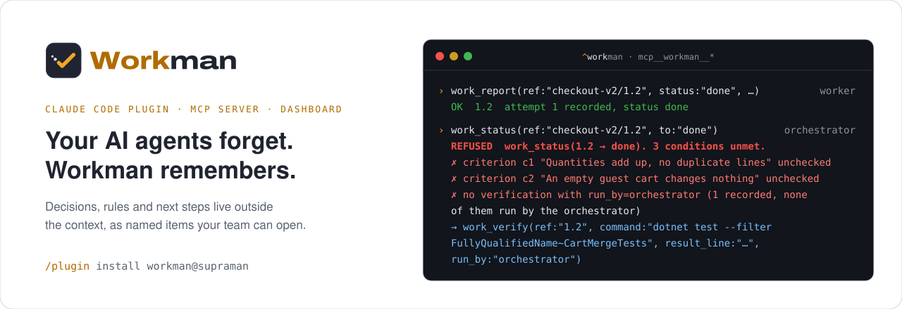
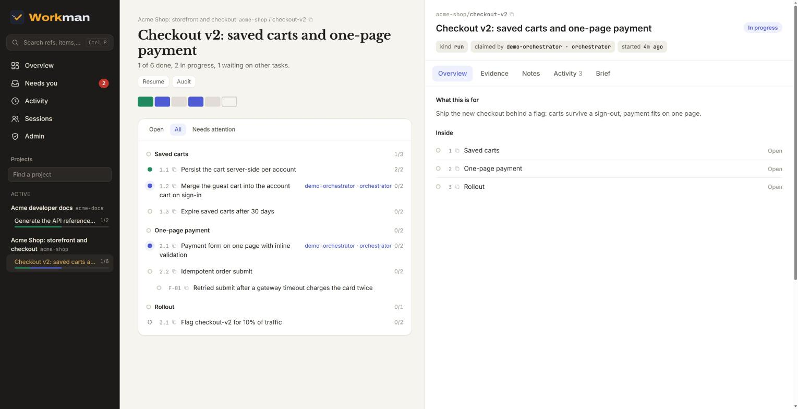
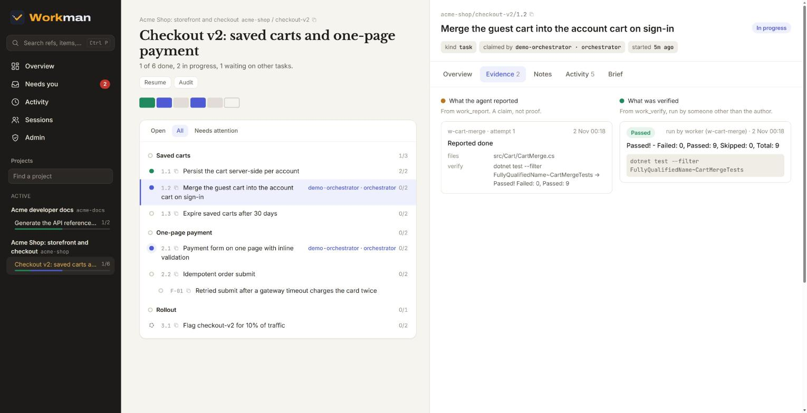
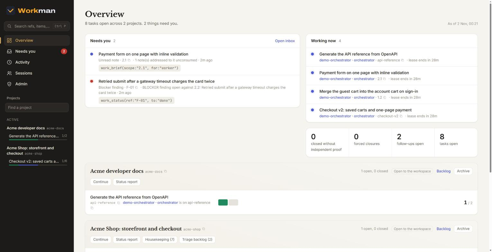
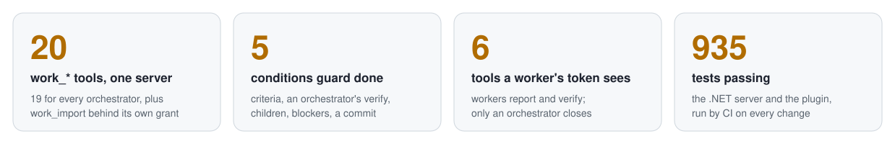

<p align="center">
  <picture>
    <source media="(prefers-color-scheme: dark)" srcset=".github/assets/hero-dark.svg">
    
  </picture>
</p>

<p align="center">
  <a href="https://github.com/getsupraman/workman/actions/workflows/ci.yml"></a>
  <a href="LICENSE"></a>
  <a href="https://github.com/getsupraman/workman/releases"></a>
  <a href="https://github.com/getsupraman/workman/pkgs/container/workman"></a>
</p>

<p align="center">
  <a href="#install"><b>Install</b></a> ·
  <a href="#what-workman-fixes"><b>What it fixes</b></a> ·
  <a href="#what-you-get"><b>What you get</b></a> ·
  <a href="#self-hosting"><b>Self-host</b></a> ·
  <a href="docs/README.md"><b>Docs</b></a>
</p>

You have seen it happen. A long agent run fills its context, the session compacts, and the agent
forgets what was decided, what's left and why. So you keep a `PLAN.md` and a `LEDGER.md`, and a few
weeks later they are dozens of files the agent gets lost in: it drops follow-ups, loses the reasons
behind decisions, and breaks rules it can no longer find. Meanwhile it tells you *"next comes M33,
then R22"* and you have no idea what M33 is. And the moment a co-worker joins, or you switch to your
other machine, the files stop agreeing with each other.

**Workman** moves all of that out of the context window and out of markdown, into one server your
agents talk to over MCP. Every task, rule, decision, note and finding is its own record with a
readable name and a link. A session that starts cold, or one that just compacted, asks for its brief
and gets the goal, where things stand, the rules that bind it and its literal next step. Your
laptop, your desktop and your team's sessions all write to the same record.

## Install

**Hosted, on [work.supraman.ai](https://work.supraman.ai)** (access by invitation today). Connect
Claude Code to it once:

```bash
claude mcp add --transport http --scope user workman https://work.supraman.ai/mcp
```

Claude Code opens a browser sign-in on first use, so you never paste a token. Then install the
skills, in Claude Code:

```
/plugin marketplace add getsupraman/workman
/plugin install workman@supraman
```

Restart Claude Code and you're done: the `mcp__workman__*` tools and the `/workman:*` skills are there.

<details>
<summary>Run it yourself instead</summary>

Install the plugin as above, then run `/workman:setup`. It starts the server and its Postgres locally
in Docker from `ghcr.io/getsupraman/workman`, registers it with Claude Code under `workman` with
browser sign-in, and backs it up on request. A machine needs Docker and nothing else.
[Self-hosting](#self-hosting) has the details.

</details>

## What Workman fixes

### 1. The context fills up, the session compacts, and the agent forgets

**The problem.** On a long run the context window fills, Claude Code compacts it, and the details go
first: what was decided, what's still open, and why. The next session starts from nothing at all.

**What Workman does.** The state lives on the server, not in the context. One call, `work_brief`,
rebuilds it for a fresh session or for the same one after compaction: the goal, where the run stands,
the rules that bind it, the open assumptions, the notes left for it, and the literal next call. It is
generated from the record every time, so it can't go stale.

**What you see.** The first call of every session is all it needs to pick up where things stand
(an abridged example; the format is specified in
[docs/06-rendering.md](docs/06-rendering.md#4-work_brief--the-recovery-payload)):

```
RUN checkout-v2  ·  branch feat/checkout-v2
GOAL Ship the new checkout behind a flag: carts survive a sign out, payment fits on one page.

WHERE  phase 1 of 3 — Saved carts. 1 of 3 tasks done, gate not yet run.
NEXT   work_status(ref:"1.2", to:"in_progress")   ← the literal next action

BINDING (2)
  ! C1   never write to the payments schema from the cart service
  · C2   run the suite with --filter CartMerge; the full suite needs a live queue

ADDRESSED TO YOU (1)
  an empty guest cart must change nothing: assert the account cart's ROW COUNT, not just its total
```

### 2. Plan and ledger files stop scaling, and the agent breaks its own rules

**The problem.** The usual fix for (1) is a `PLAN.md` and a `LEDGER.md`. They grow into dozens of
files and hundreds of kilobytes. The agent re-reads them, gets lost, loses the follow-ups and the
notes, forgets the *reason* behind a decision, and then breaks a rule because it can't retrieve it.

**What Workman does.** Every item, rule, assumption, note and finding is stored on its own, with its
dependencies and history. Instead of a file to search, the agent is handed only what binds the task in
front of it: its rules, its criteria, the findings against it, the notes addressed to it. Deferring is
a move that creates a real open item somewhere else, so nothing is dropped by being forgotten.

**What you see.** A run as phases and tasks, with a blocker finding sitting under the task it blocks:

<picture>
  <source media="(prefers-color-scheme: dark)" srcset=".github/assets/dashboard-run-dark.jpg">
  
</picture>

### 3. "Next comes M33, then R22." What is M33?

**The problem.** Whatever tracks the work, the agent talks in short refs, and you end up asking what
M33 even was, then digging through files to find out.

**What Workman does.** Every item has a readable name and a link the agent prints alongside its ref.
The dashboard has a search and a command palette (type a ref, press Enter), and one click shows the
item's definition, done-criteria, evidence, notes and history.

**What you see.** A task's evidence: what the agent reported, next to what was verified and by whom.

<picture>
  <source media="(prefers-color-scheme: dark)" srcset=".github/assets/dashboard-item-dark.jpg">
  
</picture>

### 4. A co-worker joins, or you work from a second machine

**The problem.** Every file-based approach breaks the moment there are two of you, or two machines:
the copies drift, two sessions take the same task, and nobody knows which file is true.

**What Workman does.** Workman is one server. Every session, on every machine, of everyone on the team
writes to the same record. Starting a task takes a leased claim, so two sessions don't silently work
the same thing. Work hands over between people and machines through the brief and the notes addressed
to the next task. The hosted server, [work.supraman.ai](https://work.supraman.ai), is the easy path;
[self-hosting](#self-hosting) works the same.

**What you see.** One dashboard for the whole team: what needs a person, who is working on what, and
every run's progress.

<picture>
  <source media="(prefers-color-scheme: dark)" srcset=".github/assets/dashboard-overview-dark.jpg">
  
</picture>

### And it keeps claimed apart from proven

Once the record is shared, it has to be trustworthy. An agent writes "all tests pass" and ticks the
box; in a file, nothing checks that.

<p align="center">
  <picture>
    <source media="(prefers-color-scheme: dark)" srcset=".github/assets/stats-dark.svg">
    
  </picture>
</p>

- **A report is a claim.** A task closes only when its criteria are checked and an orchestrator ran
  its verification. The refusal names exactly what's missing, as in the terminal at the top.
- **Nothing closes quietly.** A forced close is allowed, but `work_audit` lists it permanently.
- **Roles are enforced by the server.** A worker's token sees six tools: it can report and verify,
  but it can't close, create or re-plan.

### Coming

Self-service sign-up, inviting your team, and a free plan alongside paid plans.

## What you get

<table>
<tr>
<td width="50%" valign="top">

🗺️ **[`/workman:plan`](plugin/skills/plan/SKILL.md)**

**Write the plan into the record, not into a file.** A run with a goal, phases, done-criteria and a
verify command per task, binding rules and open assumptions. Then it stops and waits for you.

💬 *"Plan the saved-carts feature."*<br>
💬 *"What should we build next?"*

⚙️ Needs a Workman server

</td>
<td width="50%" valign="top">

🎛️ **[`/workman:controller`](plugin/skills/controller/SKILL.md)**

**Work through a whole backlog without one context holding it all.** It briefs a nested Claude for
each unit, steers it, verifies what came back itself, lands it and records the decision.

💬 *"Run these five issues as a controller."*<br>
💬 *"Approved, execute as `/workman:controller`."*

⚙️ Needs a Workman server

</td>
</tr>
<tr>
<td width="50%" valign="top">

🧭 **[`/workman:orchestrate`](plugin/skills/orchestrate/SKILL.md)**

**Finish a plan too big for one context window.** It delegates every task to subagents, checks each
result against the goal, and re-plans when reality diverges.

💬 *"Execute this migration plan."*<br>
💬 *"Implement this spec end to end."*

⚙️ Needs a Workman server

</td>
<td width="50%" valign="top">

🤖 **[`/workman:agents`](plugin/skills/agents/SKILL.md)**

**Give every unit of work a fresh context.** Launch named background Claude Code sessions, talk to
them over READY / BLOCKED / DONE, and get woken when one is stuck.

💬 *"Launch a worker for the cart refactor."*<br>
💬 *"Which agents are still running?"*

⚙️ Needs Node (it ships its own MCP server)

</td>
</tr>
<tr>
<td width="50%" valign="top">

🛠️ **[`/workman:setup`](plugin/skills/setup/SKILL.md)**

**One server for all your machines, running in minutes.** It finds what's missing on this machine and
does only that: pull the image, start it, register it, prove it answers. It also backs up and restores.

💬 *"Set up Workman locally."*<br>
💬 *"Back up my Workman database."*

⚙️ Needs Docker

</td>
<td width="50%" valign="top">

📥 **[`/workman:import`](plugin/skills/import/SKILL.md)**

**Retire your PLAN.md files, minus the stale parts.** It reads plan files, TODOs and ADRs, checks
each against the current code, and imports only what is still true, with its source.

💬 *"Import this repo's plans into Workman."*

⚙️ Needs a session with the import grant

</td>
</tr>
<tr>
<td width="50%" valign="top">

📊 **[The dashboard](docs/13-dashboard.md)**

**Know what M33 is in one click.** Every run, every item by name, search, and what needs you; what
each agent reported sits next to what was verified, for the whole team.

💬 *"What's blocked right now?"*<br>
💬 *"Did anyone actually run the tests on 1.2?"*

⚙️ Needs nothing: it's on the same server

</td>
<td width="50%" valign="top">

🔌 **[The `work_*` tools](docs/01-mcp-surface.md)**

**Survive compaction with one call.** `work_brief` hands a fresh session its goal, its rules and its
next step; `work_status` refuses to close what isn't proven, and says what's missing.

💬 *"Where are we?"*<br>
💬 *"Close 1.2."*

⚙️ Needs nothing: the skills call them for you

</td>
</tr>
</table>

---

## How it works

The server gives every session the same loop, in its MCP instructions:

```
work_brief → work_next → work_status(in_progress) → do the work
           → work_verify → work_status(done) → work_next
```

- **`work_brief`** is the recovery payload: the goal, where the run stands, the literal next call,
  the rules that bind you, open assumptions and notes addressed to you. It's generated, so it can't go
  stale.
- **Items have names and links.** Inside a run a ref is short (`1.2`, `F-07`); from anywhere else it
  is qualified (`checkout-v2/1.2`), and `work_brief` and `work_get` print a `web` link that opens the
  item in the dashboard.
- **`work_status(ref, "done")`** is guarded. It is refused unless every done-criterion is checked, an
  orchestrator ran a passing verification, no child is still open and no blocker finding targets it.
  It lists every unmet condition at once, with the call that fixes each. The full rules are in
  [docs/07-guards.md](docs/07-guards.md).
- **Claims are leased.** Starting work takes a claim with a lease, so two sessions don't silently work
  the same task. When a lease lapses, the task goes back to `ready` for someone else.
- **Every result ends with an `attention` block**: expired claims, assumptions past their revisit
  point, notes for the item you're about to brief.

Roles come from the token or the sign-in: workers report and verify; orchestrators and controllers
plan, judge, close and commit. The concepts are explained in [docs/concepts.md](docs/concepts.md).

## Self-hosting

`/workman:setup` is the supported path. It writes a local `.env` with random tokens, pulls
`ghcr.io/getsupraman/workman` (or builds from a clone), starts the server and Postgres with Docker
Compose, and registers `http://127.0.0.1:5290/mcp` as `workman`. The dashboard is on the same port.
The model never reads or pastes a token. [docs/install.md](docs/install.md) covers the hosted server,
self-hosting and serving one server on several hosts; to run the server from source, see
[CONTRIBUTING.md](CONTRIBUTING.md) and [server/frontend/README.md](server/frontend/README.md).

## Docs

| | |
|---|---|
| [docs/README.md](docs/README.md) | The index of every document, grouped |
| [docs/install.md](docs/install.md) | Install and self-hosting: hosted, `/workman:setup`, several public URLs |
| [docs/concepts.md](docs/concepts.md) | Projects, runs, items, criteria, verification, claims, notes, the loop |
| [docs/01-mcp-surface.md](docs/01-mcp-surface.md) | The MCP tools, their output contract and the attention channel |
| [docs/07-guards.md](docs/07-guards.md) | Forced closure: the transition table and the conditions for `done` |
| [docs/13-dashboard.md](docs/13-dashboard.md) | The dashboard: pages, the detail panel, the state vocabulary |
| [CHANGELOG.md](CHANGELOG.md) | What changed in each server and plugin version |

## Repository layout

```
.claude-plugin/marketplace.json   # the "supraman" marketplace: one plugin, workman
plugin/                           # the workman plugin: plugin.json, .mcp.json, skills/
  skills/{plan,orchestrate,controller,agents,setup,import}/
server/                           # the server (.NET 10), the dashboard (frontend/), Dockerfile
docs/                             # user guides and the design documents
.github/                          # CI, issue templates, and the images on this page
```

## Contributing

Read [CONTRIBUTING.md](CONTRIBUTING.md): how to build and test each part, pull requests to `main`,
and the CLA. Security reports go through [SECURITY.md](SECURITY.md), never a public issue. Everyone
taking part follows the [Code of Conduct](CODE_OF_CONDUCT.md).

## License

[Apache License 2.0](LICENSE); see also [NOTICE](NOTICE).
